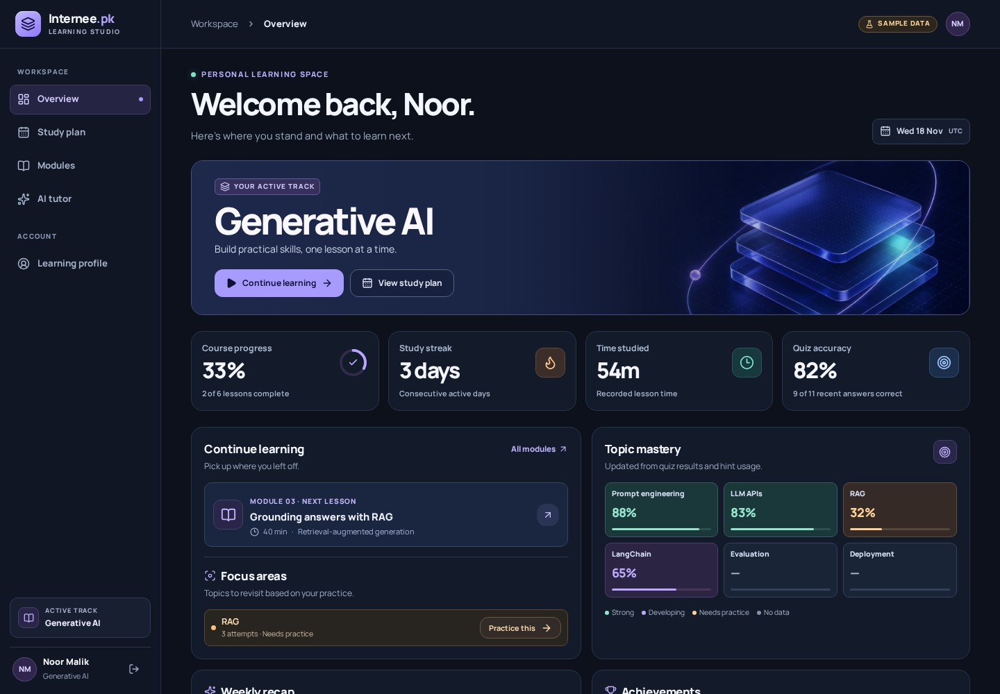
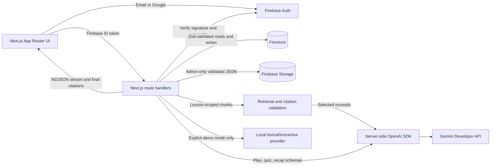

# Internee.pk Learning Studio

A personalized learning workspace for interns: a seven-day study plan, a tutor that cites lesson sections, and quizzes that turn practice into a progress record. Interns can see what to study next and why; administrators can identify where their cohort needs support.

> **Data notice:** The included curriculum, learner, and evaluation questions are original **SAMPLE** materials. They are not official Internee.pk policies, credentials, or training records.



## What’s included

- **Learner accounts:** Firebase email/password and Google sign-in; onboarding captures track, experience, available time, and a goal.
- **Study plans:** Seven dated goals grounded in the current catalog and the learner’s time budget. Opening the plan or overview triggers a refresh if a lesson was missed or recent practice is below the review threshold.
- **Lesson tutor:** Lesson-scoped retrieval, streaming answers, and clickable citations. Explain, hint, quiz, and summarize modes; assessment hints do not receive the answer key.
- **Practice and progress:** Multiple-choice and short-answer quizzes, stored attempts, mastery heatmap, focused practice links, streaks, badges, weekly recap, and a completion PDF.
- **Cohort admin:** Claim-gated overview and JSON catalog replacement backed by private Firebase Storage.

## Architecture



The browser never receives a provider secret or private answer key. Firebase Web configuration is public by design; Firebase rules and route authorization, not the Web API key, protect data. The Firebase Admin SDK is server-only. Learners can read their own records under Firestore rules; all writes go through authenticated, Zod-validated routes. MCQ grading and mastery updates are transactional. The master document ID uses the UID and a hash of the topic.

**Collections:** `users/{uid}`, `users/{uid}/progress/{lessonId}`, `modules/{moduleId}/lessons/{lessonId}/quizzes/{id}`, `lesson_index`, `lessons_chunks`, `attempts`, `mastery`, `plans`, `chats`, `summaries`, `quizQuestions`, `quizHints`, `activity`, `studyCursors`, `apiLimits`, `providerLimits`, `serviceLimits`, and `catalog/meta`.

### Stack and verified versions

| Layer       | Version / choice                                                                                 |
| ----------- | ------------------------------------------------------------------------------------------------ |
| Runtime     | Node **24.22.3** LTS and npm **11.19.1** locally; Vercel uses the current patch of Node **24.x** |
| Application | Next.js **16.4.6** App Router, React **19.3.1**, TypeScript **5.9.3** strict                     |
| UI          | Tailwind CSS **4.3.5**, shadcn/ui New York button primitive, Manrope                             |
| Firebase    | Firebase Web **13.4.0**, Admin **14.5.1**, CLI **15.36.0**; Java **21** for the local emulators  |
| AI          | OpenAI Node SDK **7.60.0**, pointed at Google's Gemini compatibility endpoint; Zod **4.6.7**     |
| Testing     | Node test runner, Firebase rules-unit-testing **6.0.0**, Playwright **1.65.1**                   |

Registry and engine checks: [versions.txt](docs/eval/versions.txt). Direct dependencies are exact and the lockfile pins transitive resolutions. `@grpc/grpc-js` is overridden to the verified patched release instead of the older version selected by the Firebase Web SDK.

## Quickstart: keyless jury demo

Prerequisites: Node matching `.nvmrc`, Java 21 on `PATH`, and network access on the first install to download dependencies and emulator binaries. No Gemini or Firebase cloud account is needed for this path.

```bash
npm ci
cp .env.example .env.local
npm run emulators                 # terminal A; wait for the Emulator Suite to be ready
```

In terminal B:

```bash
npm run seed
npm run embed -- --verify
npm run build
npm run start
```

Open `http://localhost:3000/`. The demo automatically creates an isolated emulator learner and seeds **SAMPLE** history. To try new-learner onboarding, sign out and create an account using a made-up email and password. The Google button opens Firebase’s simulated provider in demo mode; never enter a real password. See [the three-minute walkthrough](docs/DEMO_SCRIPT.md).

### Try live Gemini without paying for OpenAI

Get a Gemini API key in [Google AI Studio](https://aistudio.google.com/api-keys), set `AI_PROVIDER=gemini` and `GEMINI_API_KEY` in `.env.local`, run `npm run embed` again, and restart the app. You may leave Firebase on the emulators for this test. The example chat and embedding models are listed on [Gemini API pricing](https://ai.google.dev/gemini-api/docs/pricing) and support the [OpenAI-compatible API](https://ai.google.dev/gemini-api/docs/openai). Free-tier availability and quotas depend on the account and model. Check the provider’s data-use terms before submitting private training content. An OpenAI key is neither used nor required.

**Verify the live workflows:** With the demo `.env.local` values, an authorized staging `GEMINI_API_KEY` set locally (never in chat or Git), and the bundled model IDs or compatible env overrides, stop other local app/emulator processes and run:

```bash
npm run build
set -o pipefail
npm run verify:gemini 2>&1 | tee gemini-verification.log
```

This opt-in check sends only SAMPLE content to Gemini, starts fresh local Firebase emulators, verifies real embeddings and all five API workflows, and reports status, wall time, first tutor text, and any tokens returned by the provider. Review the limits/eligibility of the key's project; indexing alone makes one embedding call per section. No model is mocked, and missing credentials stop the command with `NOT RUN`. `null` token fields mean not reported, not zero. This is a functional smoke test, not a learning-quality evaluation.

| Environment variable                                                                                                                 | Purpose                                                                                                                         |
| ------------------------------------------------------------------------------------------------------------------------------------ | ------------------------------------------------------------------------------------------------------------------------------- |
| `NEXT_PUBLIC_DEMO_MODE`                                                                                                              | `1` for a `demo-*` project with emulators, `0` for real Firebase                                                                |
| `NEXT_PUBLIC_FIREBASE_API_KEY`, `NEXT_PUBLIC_FIREBASE_AUTH_DOMAIN`, `NEXT_PUBLIC_FIREBASE_PROJECT_ID`, `NEXT_PUBLIC_FIREBASE_APP_ID` | Public Web app configuration, compiled at build time                                                                            |
| `FIREBASE_PROJECT_ID`, `FIREBASE_STORAGE_BUCKET`                                                                                     | Backend project and exact Firebase bucket name                                                                                  |
| `FIREBASE_CLIENT_EMAIL`, `FIREBASE_PRIVATE_KEY`                                                                                      | Server credentials on Vercel; the private key may contain escaped newlines. Application Default Credentials are also supported. |
| `FIREBASE_AUTH_EMULATOR_HOST`, `FIRESTORE_EMULATOR_HOST`, `FIREBASE_STORAGE_EMULATOR_HOST`                                           | Local-only host:port settings, absent on a real project                                                                         |
| `AI_PROVIDER`, `GEMINI_API_KEY`                                                                                                      | `demo` (local only) or `gemini`; real provider key stays server-side                                                            |
| `OPENAI_CHAT_MODEL`, `OPENAI_EMBED_MODEL`                                                                                            | Required legacy names for the configurable **Gemini** model IDs                                                                 |
| `AI_DAILY_LIMIT`, `DEMO_PUBLIC_PREVIEW`                                                                                              | Optional per-user Gemini allowance (default 40/day, 12/minute); public preview refuses admin and live Gemini calls              |
| `APP_BASE_URL`, `EVAL_ID_TOKEN`                                                                                                      | Evaluation/test origin; Firebase bearer for remote evaluation, never commit it                                                  |
| `ALLOW_CATALOG_WRITE`, `ALLOW_ADMIN_GRANT`                                                                                           | Explicit hosted maintenance opt-in (`yes`), only in the maintenance environment                                                 |

Hosted browser builds also need `NEXT_PUBLIC_FIREBASE_APP_CHECK_SITE_KEY` and `APP_CHECK_MODE=required` (default; `observe` is a staging rollout mode). App Check verifies the web app separately from Firebase Auth. `AI_PROJECT_DAILY_LIMIT` and `AI_PROJECT_PER_MINUTE` cap aggregate Gemini admissions across learner accounts. For authorized hosted CLI evaluation, provide short-lived `EVAL_ID_TOKEN` and `EVAL_APP_CHECK_TOKEN` in the shell, never in Git or command output. See [abuse controls and alerting](docs/ABUSE_CONTROLS.md).

The profile’s **Learning time zone** controls the plan, streak, and rolling seven-calendar-day recap; choose `Asia/Karachi` for Pakistan time. Event timestamps and service quotas remain UTC. Legacy profiles use UTC until updated; new profiles become editable through the profile screen.

### Import an authorized curriculum

Copy the structure in [`SAMPLE_generative_ai.json`](data/sample/SAMPLE_generative_ai.json), set `source` to `IMPORTED`, and supply only authorized content. Use globally unique stable IDs, target tracks, lesson headings starting with `## `, and valid per-lesson quiz items. Reuse a lesson ID only when the lesson retains its meaning, so old progress remains defensible.

- **CLI:** `npm run seed -- path/to/curriculum.json`, then `npm run embed`. Hosted maintenance requires `ALLOW_CATALOG_WRITE=yes`; use an environment pointing at the intended Firebase project.
- **Admin UI:** Create a Firebase account and save its profile. Run `npm run admin:grant -- <account-email>` in a trusted maintenance shell; sign out and back in to refresh the custom claim. Open `/admin`, upload the JSON, and run the indexer after a changed revision. Lesson reads work after publication; changed sections return `INDEX_PENDING` until re-indexed instead of citing stale material. Uploaded archives are private.

## API reference

All routes below except `/api/health` require `Authorization: Bearer <Firebase ID token>`. JSON bodies require `Content-Type: application/json`. Errors use `{ "error": { "code": "…", "message": "…" } }`. Missing or invalid tokens return `401`.

| Method and path                           | Input → output                                                                                                               |
| ----------------------------------------- | ---------------------------------------------------------------------------------------------------------------------------- |
| `GET /api/health`                         | Process liveness → `{status:"ok"}` (not downstream readiness)                                                                |
| `GET / PUT /api/profile`                  | GET own profile; PUT onboarding fields plus optional IANA `timeZone` → `{profile,admin}`                                     |
| `GET /api/catalog`, `GET /api/lesson/:id` | Published previews and full lesson content                                                                                   |
| `GET / POST /api/plan`                    | GET saved plan and refresh reason; POST `{uid,refresh?}` → `{days:[{date,lessonIds,goal,minutes,reason}]}`                   |
| `GET / POST /api/tutor`                   | GET `?lessonId=` for recent chat; POST `{lessonId,mode,message,questionId?}` → newline-delimited frames                      |
| `POST /api/quiz/generate`                 | `{lessonId,n,topic?}` → public `questions` and provider label; answer keys are intentionally omitted                         |
| `POST /api/quiz/grade`                    | `{questionId,answer}` → `{correct,feedback}`                                                                                 |
| `GET / POST /api/progress`                | GET `?lessonId=`; POST `{lessonId,interval?:{fromMs,throughMs},complete?:boolean}` → `{completed,studySeconds,serverTimeMs}` |
| `GET /api/dashboard`                      | Learner progress, weak topics, current lesson, and badges                                                                    |
| `GET / POST /api/summary`                 | GET cache; POST `{}` → `{summary}` containing the weekly recap                                                               |
| `GET /api/certificate`                    | PDF only after track completion                                                                                              |
| `GET /api/admin`                          | Claim and current account checked → cohort overview                                                                          |
| `POST /api/admin/import`                  | Claim and current account checked; raw JSON file with `X-Filename` → revision and counts                                     |
| `POST /api/demo`                          | Signed-in `@sample.invalid` emulator session → isolated sample profile/history                                               |

Tutor frames are `{"type":"delta","text":"…"}`, then `{"type":"done","citations":[{"lessonId":"rag","chunkId":"rag--01"}]}`. A failure after headers uses an `error` frame. The server maps model evidence slots to retrieved IDs before releasing text. JSON Schema outputs are checked by Zod and by application validation. Timeouts, bounded transient retries, token caps, embedding caching, and transactional quotas control model cost. Logs contain provider usage and timings, not prompts or ID tokens. Per-action API limits are independent of the Gemini allowance. Fixed hints, deterministic MCQ grading, keyless demo outputs, cached plans/recaps that skip inference, and admin imports do not spend it. A tutor request that calls both query embedding and chat consumes one Gemini admission.

## Testing and evaluation

```bash
npm run lint && npm run format:check && npm run typecheck
npm run test:unit
# With the built app and emulators running:
npm run test:rules
npm run test:api
npm run test:e2e
npm run eval:tutor
# Or, with emulator and app ports free, run the workflow's integration sequence:
npm run ci:integration
```

Before running Playwright for the first time, install Chromium with `npx playwright install --with-deps chromium`. [Milestone logs](docs/eval) include the actual commands and output. The [labelled evaluation](docs/eval/tutor-demo.txt) scores citation-label agreement and off-topic refusals over the SAMPLE questions. Those are keyless demo results, not a claim about Gemini or a measure of whether each statement is supported. **Live Gemini evaluation: NOT RUN.** The local first-text smoke test and the full benchmark report separate timings because they use different request sets.

| Measured locally                                    | Result                         | Evidence                                                       |
| --------------------------------------------------- | ------------------------------ | -------------------------------------------------------------- |
| In-scope answers with the expected citation         | **100% (16/16)**               | `npm run eval:tutor` · `docs/eval/tutor-demo.txt`              |
| Off-topic cases declined                            | **100% (4/4)**                 | Same labelled benchmark                                        |
| Time to first visible text (warmed demo HTTP route) | **28.4 ms p50 / 43.5 ms p95**  | Same labelled benchmark                                        |
| Unit / rules / HTTP API / browser tests             | **5 / 5 / 4 / 4 passed**       | `docs/eval/M9.txt`                                             |
| Production npm audit                                | **0 vulnerabilities reported** | `npm audit --omit=dev --audit-level=high` · `docs/eval/M9.txt` |

The table above is the original M9 baseline. Current corrections, their workflow checks, and evidence are in [the review log](docs/REVIEW_FIXES.md). Hosted GitHub Actions and Vercel: **NOT RUN**.

### Tutor quality beyond citation labels

The stricter [SAMPLE quality set](data/sample/SAMPLE_tutor_quality_eval.json) tests cross-section reasoning, user and source injections, and incorrect or conflicting source text. `npm run ci:integration` runs `eval:quality` against fresh local emulators and saves answers, cited excerpts, independent reference facts, and automated diagnostics. Citation IDs and keyword matches are **not** correctness scores. For a live run on SAMPLE only, add `RUN_GEMINI_QUALITY=1` to `npm run verify:gemini` (adds provider calls). See the [claim-review rubric](docs/TUTOR_REVIEW.md) and current evidence in `docs/eval`.

### Screenshots

| View              | Preview                                                                           |
| ----------------- | --------------------------------------------------------------------------------- |
| Dashboard         | [Desktop](docs/screenshots/dashboard.jpg) · [Mobile](docs/screenshots/mobile.jpg) |
| Tutor             | [Lesson with source citation](docs/screenshots/lesson-tutor.jpg)                  |
| Hosted admin      | Placeholder — add after hosted verification                                       |
| Hosted study plan | Placeholder — add after hosted verification                                       |

## Deploy on Vercel

1. Create a real Firebase project. Enable Firestore and Email/Password and Google providers. Set up Cloud Storage if you need admin uploads. [Firebase requires Blaze billing for hosted Cloud Storage](https://firebase.google.com/docs/storage/faqs-storage-changes-announced-sept-2024); no-cost usage is still subject to quotas. Emulators do not require billing.
2. From a trusted Firebase CLI session deploy rules and indexes: `npx firebase deploy --only firestore:rules,firestore:indexes,storage --project <project-id>`. If not using Storage uploads, omit `storage` and keep the bucket setting set to the intended project bucket name.
3. Push the local repository to a GitHub repository you own and import it into Vercel as Next.js with Node 24.x. Set the hosted environment values above, register App Check and configure edge protection as described in [the staging checklist](docs/ABUSE_CONTROLS.md), and remove all emulator variables. Never place a service-account JSON file or Gemini key in Git. Add the Vercel hostname to Firebase Auth authorized domains and test Google in a top-level tab.
4. Seed and embed against the real backend from a trusted shell. Confirm `/api/health`, sign-in, lesson citations, grading, and admin upload as applicable. Use the appropriate test learner and separate staging credentials when running the eval remotely.

**Docker alternative:** Configure `.env.local` for hosted Firebase and Gemini, then run `docker compose --env-file .env.local up --build`. Build args contain only public Firebase settings. The runtime is non-root, uses the Next.js standalone bundle, and has a liveness check. Docker/Compose build, non-root startup and liveness passed with placeholders; authenticated cloud dependencies were **NOT RUN** in the container. See [the hosted verification checklist](docs/HOSTED_VERIFICATION.md). No Python service is part of this stack.

## Verified source packaging

From a Git checkout (with Git, Node, and `unzip` available), use `npm run release:check` to audit the committed tree, or `npm run release:zip` to build the audited source ZIP and its per-file SHA-256 manifest in `.release-local/`. The archive uses `git archive HEAD`, not a recursive workspace ZIP. Commit intended changes first. The check rejects ignored or local artifacts, symlinks, nested archives, and common credential patterns without printing secret values. The ZIP's member list must exactly match the audited source tree. `.env.example`, source, assets, and intentional evaluation records are included; local env files, build output, caches, dependency folders, and debug logs are not.

## Limitations and next steps

- The demo has no live inference. It uses real emulator persistence, lexical vectors, curated questions, deterministic grade and planning, and an aggregate recap template. See [known gaps](docs/KNOWN_GAPS.md).
- This is a bounded internship cohort app. Benchmark real retrieval, validate groundedness with independent questions and human claim-level review, then migrate to indexed ANN retrieval and precomputed cohort analytics if scale requires it.
- Study time is reported while the lesson tab is visible, every 15 seconds and on hide, navigation, and completion. The server bounds each interval and the cumulative lesson total; repeated and overlapping reports do not add the same time twice. Exit saves are best effort when a browser closes or is offline. Certificates acknowledge completion in this app, not verified proficiency or an official Internee.pk credential. An extended certificate font and optional inactivity notifications are future work.

[Implementation assumptions](docs/ASSUMPTIONS.md) · [Demo script](docs/DEMO_SCRIPT.md) · [Known gaps](docs/KNOWN_GAPS.md)
